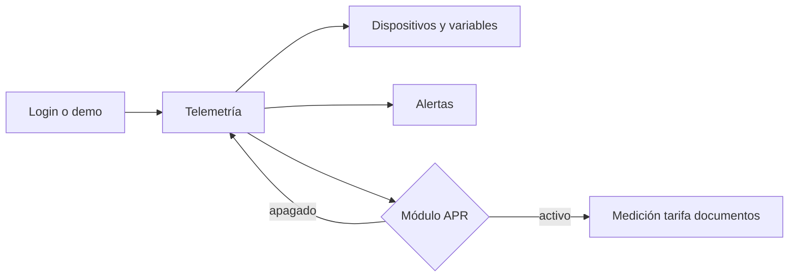

# Arquitectura — Nxord

SPA Vite. La capa de datos está en `src/lib/api/` (`client`, tipos, hooks y demo).

## Estructura

```
src/pages          Home, Login y la app (dashboard, dispositivos, alertas, APR, tarificación)
src/components     shell, dashboard, dispositivos, alertas, APR, tarificación, ui
src/lib/api        cliente Token + X-Branch-ID, con fallback demo
src/lib/modules.ts activación del módulo APR
```

## Dos modos de producto



El core cubre el tablero, los equipos y las alertas. El módulo APR suma el ciclo de cobro. Los datos de los dos salen de la misma API, de los módulos `iot_telemetry`, `finance` y `customers`.

## Sesión

`login_complete` devuelve el token y las sucursales. El selector guarda el id y lo manda en `X-Branch-ID`. Sin token, las pantallas leen el demo de `src/lib/api`.
